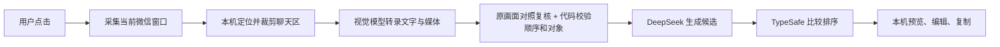

# Jev Amazing · 微信神回复侧边助手

**在微信里聊，需要灵感时点一下。读懂当前文字、图片和表情包，给你几句可以修改再发送的回复。**

适用于 Apple Silicon Mac 的原生侧边小窗。不必复制聊天去另一个 AI 应用，不必手填联系人名字，也不必单独上传聊天里的图片。打开会话，点击 **「识别当前聊天并生成」**，核对对象，选择你想说的话。

> 基于 [Jev 聊天助手 macOS](https://github.com/jev-chat/jev-chat-jarvis-mac) 二次开发，保留 [MIT LICENSE](LICENSE) 与 [NOTICE](NOTICE)。这是独立衍生版本，与上游作者、微信及腾讯均无关联，不代表其出品或背书。

## 它适合做什么？

朋友抛来一句调侃，你想接住；对方连发几张猫图，你想回得有趣一点；或者你只是想摆脱每次都回「哈哈哈」。

例如，对方先发「你昨天也是这么说的」，随后发一个无字猫表情。助手会把**最后的表情作为回复对象**，结合前文生成候选，而不是继续回答更早的文字。它提供灵感，不保证每句都好笑，也不会替你决定或发送。

## 特色

- **一键处理当前会话**：自动读会话标题、可见文字和图片／表情包；无需手动上传。
- **先理解，再生成**：同一帧画面转录发送方、消息顺序与媒体内容，再对照画面复核最后消息；回复目标由代码从已校验的顺序中确定，避免模型重复填写目标 ID 造成误拦截。
- **五种表达方向**：接梗、轻怼、轻撩、自嘲、自然；搭配收着点、刚刚好、放开点三档力度。它们是提示词控制，不是客观幽默评分。
- **候选可以改**：侧边直接编辑、复制；完整窗口可补关系背景、选择 1–5 条、再来一组和保存 TXT。
- **跟随微信收起**：微信最小化时助手一起隐藏，恢复后候选和修改保留。
- **按需而非持续读屏**：只有主动点击才采集和请求模型，平时只查询窗口位置、可见性等元数据。
- **固定启动器、独立更新**：Python 代码使用版本化载荷，日常代码更新不重签启动器，减少录屏授权因签名变化而失效的问题。
- **你掌握发送权**：不注入、不 hook、不解密聊天数据库；本版不自动填入或发送微信消息。

## 先了解支持范围

当前提供**源码安装**，没有已公证、包含全部运行时的一键安装包。

- Apple Silicon Mac（M 系列），macOS 13+；实际端到端验证环境为 macOS 26.2。Intel、其他系统版本、多屏和复杂群聊尚未充分验证。
- 微信 macOS 客户端与系统「屏幕录制」权限。
- 网络连接，以及**你自己的、具备对应模型权限和可用额度的 OpenRouter 普通推理 API Key**。管理 Key 不能代替推理 Key。
- [uv](https://docs.astral.sh/uv/getting-started/installation/)、Git 和 Xcode Command Line Tools。安装脚本用 uv 准备 Python 3.12 和固定版本云端依赖，不安装 torch、不下载本地模型。

## 安装与配置

### 1. 获取源码与准备工具

```sh
git clone https://github.com/yxjsxy/jevchat-amazing-response-macos.git
cd jevchat-amazing-response-macos

# 尚未安装编译工具时执行，并完成系统安装弹窗
xcode-select --install

# 检查 Apple Silicon、uv 和 clang 是否可用
./setup.command --check
```

uv 的安装方法见[官方说明](https://docs.astral.sh/uv/getting-started/installation/)。

### 2. 安装应用

```sh
./setup.command
```

脚本创建隔离运行时、构建并安装到 `~/Applications/Jev Amazing.app`，已有私人配置不会被覆盖。首次运行需要联网安装 Python／依赖。原生应用未做 Apple 公证，可能需要通过 macOS 的正常安全确认流程打开；不要关闭系统安全保护。

### 3. 填写你自己的 Key

配置文件独立放在仓库之外：

```sh
open -e "$HOME/Library/Application Support/Jev Amazing/config/env"
```

对照仓库中的 [amazing.env.example](amazing.env.example)，填写：

```dotenv
# 用你自己的 OpenRouter 普通推理 Key，仓库不提供共享 Key
OPENAI_API_KEY=
OPENAI_BASE_URL=https://openrouter.ai/api/v1
OPENAI_MODEL=deepseek/deepseek-chat-v3.1

# 可以填写同一把 OpenRouter Key；排序接口必须有 Key
TYPESAFE_API_KEY=
TYPESAFE_BASE_URL=https://openrouter.ai/api/alpha/decisions
TYPESAFE_MODEL=typesafe/jev-1.13

# 默认继承 OPENAI_API_KEY / OPENAI_BASE_URL，无需另配 Google Key
JEV_VISION_MODEL=google/gemini-2.5-flash
```

把 Key 填在等号后，保存并重开应用。脚本对配置目录设置 `0700`、配置文件设置 `0600`；**不要把实际 Key 写进源码、提交记录、截图或 issue**。需要独立视觉服务时，可另外设置 `JEV_VISION_API_KEY` 和 `JEV_VISION_BASE_URL`，并选择支持图片输入及所需 JSON 输出的兼容模型；其他服务组合未全面测试。

### 4. 打开并授权

```sh
./start.command
# 或者
open "$HOME/Applications/Jev Amazing.app"
```

在 macOS「系统设置 → 隐私与安全性 → 录屏与系统录音」允许 **Jev Amazing**，按系统要求退出并重开，然后恢复微信窗口。首次授权／替换原生启动器时可能需要系统确认；正常 Python 载荷更新保持启动器签名不变。权限始终由 macOS 管理，本项目不会绕过它。

## 日常怎么用？

1. 在微信进入想回复的会话，保持聊天标题、最近消息与底部输入区边界可见。
2. 选择风格和力度，点 **「识别当前聊天并生成」**。
3. 等待窗口采集、视觉理解、画面对照校验、生成与排序；可取消。
4. 核对界面显示的**会话名和回复对象**，阅读并修改候选。
5. 点 **「复制这句」**，自行回微信粘贴、发送。切换会话后再次点击，旧候选不代表新聊天。

「设置」可打开完整编辑窗口，修改关系背景、识别文本及候选数量，或保存草稿。「再来一组」复用当前输入换思路；重新读取微信请用「识别并生成」。微信最小化时助手同步收起。完全退出用菜单栏的 J 菜单 → 退出。

## 模型与数据流



默认通过 OpenRouter 调用 Gemini 2.5 Flash 做视觉转录与复核、DeepSeek Chat v3.1 做生成、TypeSafe Jev 1.13 做排序。**裁剪后的聊天图片会离开本机，识别文字也会用于云端生成和排序**。这不是纯离线应用，接口计费使用你的账号额度，模型可用性与价格由服务商决定。

裁剪排除联系人列表和输入草稿；边界无法确认则停止，不上传整个桌面兜底。不承诺自动脱敏，点击前请确认画面适合发送给所配置服务。详情见 [PRIVACY.md](PRIVACY.md)。

## 能力边界

- 理解的是**屏幕上可见的图片／表情当前帧**，不会自动打开原图；动态表情完整动画、音频、音乐、视频及文件正文不在当前能力范围。
- 最后一条是我方、媒体内容不明确、顺序／归属复核不一致，或最后是未读取内容的音视频／文件卡片时，会停止并显示原因，不悄悄回答旧消息。
- 视觉模型可能看错、漏掉消息或误判表情含义。情绪解读是推测；复核和排序不是正确性保证，发送前需要本人确认。
- 最近 10 条用于生成，每轮 1–5 候选；图片长边超过 2048 像素时等比缩小、JPEG 质量 0.9。每接口 25 秒、整轮 90 秒和单任务限制用于资源／费用保护，不代表硬件极限。
- 取消只停止本机接收；已经提交的云端请求可能继续执行和计费。
- 启用历史的上游代码仍保留，但本版默认历史关闭、持续读屏停用。其他聊天应用适配器的存在不代表本版已完成相应验收。

## 遇到问题

**录屏开关开着，仍无法读取？** 确认启动的是 `~/Applications/Jev Amazing.app`，不是旧副本；恢复微信并确保窗口可见。首次迁移、原生启动器或签名变化后，按系统提示重新授权并重开应用。普通代码更新不应要求反复开关权限。

**提示消息顺序／回复对象不确定？** 检查窗口是否被裁切、遮挡或刚切换会话；待画面稳定后再点。也可在完整窗口手动纠正识别文本再生成，不要把旧候选当当前结果。

**接口报错或超时？** 检查 Key 是否是普通推理 Key、账号额度、网络和对应模型权限。视觉、生成和排序分别需要接口可用；仓库不包含可代用的公共 Key。

**生成成功但不好笑？** 换风格、降低力度、补充真实关系背景，或者直接修改候选。项目的价值是减少操作并提供灵感，尚未证明比直接向同一模型提问有更高的幽默质量。

反馈时请只提供脱敏后的错误、系统版本和复现步骤，不要附 Key、真实私人聊天或完整配置。日志位于 `~/Library/Logs/jev-amazing.log`，分享前也请自行检查。

## 开发与更新

```sh
# 安装后已有隔离运行时
RUNTIME="$HOME/Library/Application Support/Jev Amazing/venv/bin/python"
PYTHONPATH=src "$RUNTIME" -B -m unittest discover -s tests

# 拉取更新后重新安装；不覆盖私人 env
# 会退出当前 Jev Amazing，再切换版本化 Python 载荷
./setup.command
```

当前 364 项回归测试通过，1 项跳过。测试覆盖消息顺序、目标选择、过期结果、复制相关逻辑等，**不等同于模型质量评分**。真实微信已验证图像／末条猫表情一键生成、末条我方消息阻止、编辑复制及最小化恢复；同一媒体窗口三次独立生成约 15.7–23.4 秒，仅为单机有限样例，不是延迟承诺。测试退出时仍可能出现 `sem_unlink` 清理警告，已知验证进程退出码为 0。

核心代码：`src/visual_chat.py`（视觉读取与校验）、`src/amazing.py`（神回复提示与有限检查）、`src/amazing_window.py`（完整窗口与任务流程）、`src/quick_reply.py`（侧窗与微信联动）、`packaging/`（固定签名启动器与版本化载荷）。

## 致谢与来源

感谢 **eatmoreduck 与 jev-chat 贡献者**开源原生聊天副驾的基础实现。

- 本版直接上游：[jev-chat/jev-chat-jarvis-mac](https://github.com/jev-chat/jev-chat-jarvis-mac)，采用基线 [`cbf6fe45aedbe78652c46fe87357ae4761dd9a79`](https://github.com/jev-chat/jev-chat-jarvis-mac/commit/cbf6fe45aedbe78652c46fe87357ae4761dd9a79)。
- 相关原始 Jev 安卓项目：[jev-chat/jev-chat-jarvis](https://github.com/jev-chat/jev-chat-jarvis)。本仓库只交付 macOS 版本。
- 保留的上游说明：[README_UPSTREAM.md](README_UPSTREAM.md)，用于追溯，安装及隐私行为请以本 README 和本版隐私说明为准。
- 复用的基础：原生 AppKit/PyObjC 窗口、只读采集与 OCR、模型接口、复制及设置基础设施。
- 本版主要改动：神回复风格与力度、按需多模态一键流程、独立画面复核与代码目标选择、可编辑侧边候选、微信最小化联动、固定签名启动器／外部载荷更新。

本仓库以清理后的源码快照发布，不携带开发机器的私人配置、聊天验收文件或旧 Git 历史。原作者版权、MIT 许可证与 NOTICE 保留；请勿暗示原作者为本衍生版本背书。
